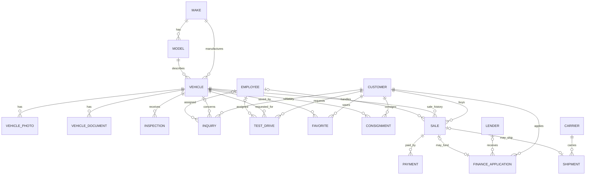

# Database schema and ER diagram

PostgreSQL schema for the dealership application. Executable migrations are in [`../supabase/migrations/`](../supabase/migrations/); [`schema.sql`](schema.sql) combines them as a reference snapshot.

## Tables and relationships

| Table | Purpose and cardinality |
|---|---|
| `customer` | Buyer, seller, or inquiry contact. One customer can have many inquiries, test drives, consignments, sales, favorites, and finance applications. `auth_user_id` is optional and unique; `email_normalized` is unique for case-insensitive contact upserts. Synthetic seed customers are marked `is_demo`. |
| `employee` | Staff identity and role, optionally linked to one Supabase Auth user. Employees can be assigned to inquiries, test drives, inspections, and sales. |
| `make` | Normalized manufacturer lookup. One make has many models and vehicles. |
| `model` | Normalized model lookup, unique by `(make_id, normalized_name)`. Composite unique `(id, make_id)` supports vehicle make/model consistency. |
| `vehicle` | Current listing and inventory record, including a staff-controlled featured flag. Has one make and model; has many photos, documents, inspections, inquiries, test drives, consignment history, and sale history. Source fields are all-null for manual records or all-present for imported records. Fictional seed inventory is marked `is_demo` and excluded from the public catalog. |
| `vehicle_photo` | Multiple ordered images per vehicle, with at most one primary image. Storage path references the `vehicle-photos` bucket. |
| `vehicle_document` | Private documents attached to a vehicle. References the `vehicle-documents` bucket. |
| `inspection` | Appendable inspection history; optionally identifies the employee and document. Public view reveals only date and result for published vehicles. Can be marked `is_demo`. |
| `inquiry` | Customer message, optionally about a vehicle, optionally assigned to an employee. Status uses the required workflow values. Can be marked `is_demo`. |
| `test_drive` | Customer request for a vehicle and optional assigned employee; request can later receive a scheduled time. Can be marked `is_demo`. |
| `consignment` | Historical agreement between a seller and vehicle. Partial unique index permits at most one `active` or `pending_sale` agreement per vehicle. Can be marked `is_demo`. |
| `sale` | Vehicle purchase history. Partial unique index permits at most one `pending` or `completed` sale per vehicle. A customer may buy multiple vehicles over time. Can be marked `is_demo`. |
| `payment` | One sale can have multiple payment records. Can be marked `is_demo`. |
| `lender` | Finance provider referenced by finance applications; demo lookup entries are marked `is_demo`. |
| `finance_application` | Customer financing workflow; may refer to a sale and lender. A sale can be linked to at most one application. Sensitive fields stay staff-only; demo rows are marked `is_demo`. |
| `carrier` | Shipping provider referenced by shipments; demo lookup entries are marked `is_demo`. |
| `shipment` | Optional one-to-one shipment per sale, associated with one carrier. Can be marked `is_demo`. |
| `favorite` | Customer-to-vehicle join table with a unique pair constraint; can be marked `is_demo`. |

## Integrity rules

- UUID primary keys default to `extensions.gen_random_uuid()`.
- Foreign keys restrict deletion of referenced business records where preserving history matters; photos, documents, inspections, and favorites cascade when a vehicle is deleted.
- Checks validate years, nonnegative mileage and prices, positive payment and sale amounts, ISO-style three-letter currency codes, commission percentages, and enum statuses.
- VIN and import `(source_dataset, original_record_id)` are unique when present.
- Vehicle make/model consistency is enforced with a composite foreign key.
- Partial unique indexes enforce no concurrent active sales and no concurrent active consignments per vehicle.
- Search, browsing, status queues, common joins, schedules, and history have supporting indexes.

## Access model

- Public catalog reads go through `public.public_vehicle`, which excludes internal provenance and returns VIN only when `public_vin` is true. It includes joined make/model labels and a search field. `public.public_inspection_summary` excludes notes, document IDs, and employee IDs.
- `public.admin_dashboard_summary` is a `security_invoker` aggregate view available only to authenticated users and returns a row only when `private.is_staff()` succeeds. Its totals and chart series are computed in PostgreSQL rather than by loading whole tables into the admin browser; CRM metrics exclude rows marked `is_demo`.
- `public.admin_customer_activity` computes inquiry, test-drive, and completed-purchase counts per customer in PostgreSQL for authorized staff. `public.admin_demo_record_counts` gives authorized staff a separate count of synthetic workflow data.
- Public listing images live in a public-read bucket; uploads and mutations require an active admin/manager employee.
- Vehicle documents are private and accessible only to active admin/manager users.
- Customer and operational tables have RLS enabled and no anonymous grants. Authenticated access is limited by the `private.is_staff()` policy helper.
- Contact and test-drive form submissions are deliberately not exposed as direct anonymous table inserts. The application validates them in server-side API routes and uses the server-only admin client after validation.
- The service-role key bypasses RLS and must remain server-only. Prefer the publishable-key client plus RLS for ordinary requests.

## Applying the migration

Apply SQL files in `supabase/migrations/` in filename order. The first establishes the dealership schema; `20261103100000_demo_inventory_support.sql` is an additive follow-up for demo inventory isolation. Review the target project before applying. The combined `database/schema.sql` is a reference snapshot and should not be run in addition to the migrations.
